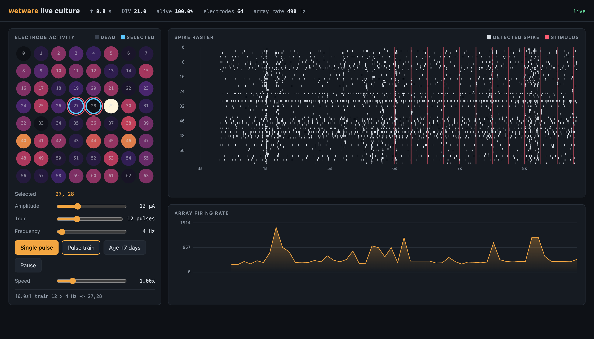
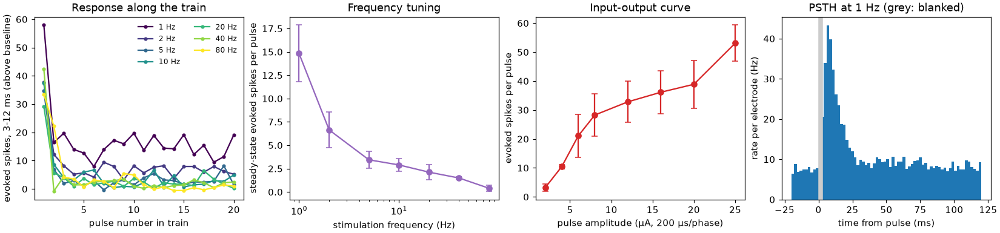
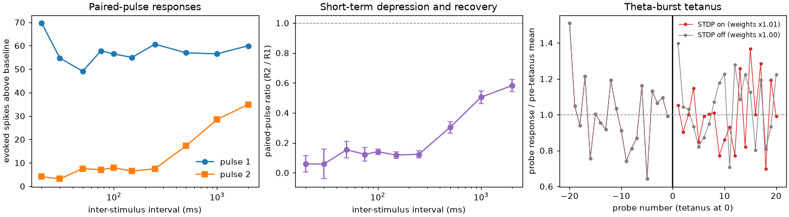
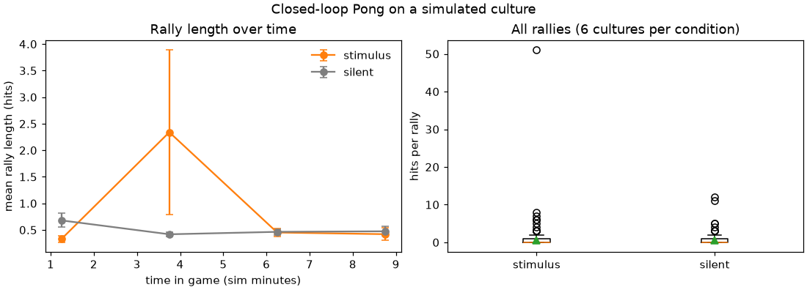

# wetware-emulator

[](https://github.com/veermshah/wetware-emulator/actions/workflows/ci.yml)
[](https://veermshah.github.io/wetware-emulator/)
[](LICENSE)

A simulated cortical culture on a virtual multi-electrode array (MEA), with
the kind of API you would use to run experiments on real neurons remotely:
stimulate electrodes, record spikes, close the loop, watch the culture age.



## Why I built this

Biological computing experiments are hard to get started with. Living
neurons on MEAs can now be reached over the internet (Jordan et al., 2024),
and closed-loop work such as neurons playing Pong (Kagan et al., 2022) has
made the field very visible, but access is scarce, slow and expensive, and I
don't have a wet lab. I wanted a place to write and debug the whole
experiment first: the stimulation protocol, the closed-loop logic, the
analysis and the file handling, against something that behaves roughly like a
culture and fails in the same ways (stimulation artifacts, noisy electrodes,
bursts that swamp your evoked response, electrodes that die).

This is a model, not real neurons. See [Limitations](#limitations).

## Quickstart

```bash
git clone https://github.com/veermshah/wetware-emulator && cd wetware-emulator
python3.12 -m venv .venv && source .venv/bin/activate
pip install -e ".[dev]"
wetware demo --plot demo.png
```

In five lines of Python:

```python
from wetware import Culture, biphasic_pulse

culture = Culture(n_neurons=1000, seed=42)  # 8x8 MEA, 200 µm pitch
culture.stimulate([27, 28], biphasic_pulse(amplitude_ua=10, phase_us=200))
rec = culture.record(duration_ms=1000)  # -> SpikeTrains
print(rec.firing_rates_hz.reshape(8, 8))
```

Docs: <https://veermshah.github.io/wetware-emulator/>

## What is in it

- **Simulation core (NumPy).** Izhikevich neurons (80 % excitatory) placed in
  2D, distance-dependent connectivity, short-term plasticity, STDP, and
  spontaneous network bursts. LIF is built in too, and you can plug in your
  own neuron model.
- **Virtual MEA.** Spikes become extracellular waveforms on nearby
  electrodes, with thermal noise, stimulation artifacts, a blanking window
  and threshold spike detection. You get what a rig gives you (detected
  spikes per electrode, MUA, optional raw traces), and ground truth if you
  ask for it.
- **Stimulation with safety limits.** Biphasic pulse helpers and pulse
  trains. Unbalanced or over-limit waveforms raise instead of being clipped.
- **Closed loop on the simulation clock.** `culture.closed_loop(callback, hz)`
  calls you at an exact rate in simulated time, with a configurable
  decision-to-stimulus latency.
- **Health drift.** `culture.age(days)` matures and then degrades the
  culture: firing rates decay, bursts thin out, neurons die, electrodes drop
  out.
- **HDF5 export.** NWB-like layout, documented in
  [docs/file-format.md](docs/file-format.md), with a loader.
- **HTTP server and client.** `wetware serve` exposes the same operations
  over HTTP, and `WetwareClient` mirrors the local API, so an experiment
  looks like remote-platform work.
- **Live dashboard.** `wetware dashboard` streams a running culture to the
  browser: electrode heatmap, raster, firing rate and stimulation buttons.
- **YAML protocols.** `wetware run protocol.yaml` executes trains, ramps,
  closed-loop blocks and aging steps and writes HDF5 plus a summary figure.
- **Analysis.** Burst detection, rate maps, PSTHs, cross-correlograms,
  functional connectivity, and plotting helpers.
- **Batches.** Run many cultures across seeds and ages in parallel.

## API in one screen

```python
from wetware import Culture, MEA, biphasic_pulse, pulse_train, load_hdf5
from wetware.analysis import detect_bursts, psth

culture = Culture(n_neurons=1000, seed=1, mea=MEA(rows=8, cols=8, pitch_um=200))

# Open loop
culture.stimulate([27], pulse_train(amplitude_ua=12, n_pulses=20, frequency_hz=5))
rec = culture.record(5000, raw=True)  # rec.times, rec.mua(10), rec.voltage_uv
bursts = detect_bursts(rec)
centres, rate = psth(rec)


# Closed loop at 50 Hz of simulated time
def callback(frame):
    if frame.counts[[10, 11]].sum() >= 3:
        frame.stimulate([27], biphasic_pulse(8))


with culture.closed_loop(callback, hz=50, latency_ms=2) as loop:
    loop.run(duration_ms=10_000)

# Lifetime and storage
culture.age(days=30)  # -> Health(div, alive_fraction, ...)
loop.recording.to_hdf5("outputs/session.h5")
again = load_hdf5("outputs/session.h5")
```

Safety checks raise:

```python
from wetware import Waveform, Phase

culture.stimulate([0], Waveform((Phase(-10, 200),)))
# StimulationSafetyError: waveform is not charge-balanced (net -2 nC); ...
```

The same experiment against a server:

```python
from wetware.client import WetwareClient  # after `wetware serve`

culture = WetwareClient("http://127.0.0.1:8000").create_culture(n_neurons=1000, seed=1)
culture.stimulate([27], biphasic_pulse(10))
rec = culture.record(1000)
```

More in [docs/api.md](docs/api.md); the model and its equations are in
[docs/model.md](docs/model.md).

## Command line

```text
wetware demo                      spontaneous + evoked activity, printed summary
wetware dashboard                 live UI at http://127.0.0.1:8050
wetware serve                     HTTP API at http://127.0.0.1:8000 (OpenAPI at /docs)
wetware run protocols/stimulus_response.yaml
wetware batch --seeds 0-7 --divs 14,21,35
wetware bench
```

A protocol looks like this:

```yaml
name: stimulus_response
culture: {n_neurons: 1000, seed: 1, div: 21}
blocks:
  - {type: rest, duration_ms: 5000}
  - {type: ramp, electrodes: [27], start_ua: 2, stop_ua: 20, steps: 10, interval_ms: 500}
  - {type: train, electrodes: [27], amplitude_ua: 12, n_pulses: 20, frequency_hz: 20}
  - type: closed_loop
    hz: 20
    duration_ms: 5000
    rule: {type: threshold, watch: [36, 37], threshold: 3, stimulate: [27], amplitude_ua: 8}
```

## Examples

Each script in `examples/` runs on its own, takes `--quick` for a short
run, and writes its figure to `docs/img/`.

### Frequency tuning

`python examples/frequency_tuning.py` drives two electrodes with 20-pulse
trains from 1 to 80 Hz. The culture follows 1 Hz and falls off quickly above
that, because excitatory synapses depress and recover over seconds. Averaged
over 4 cultures, the steady-state response drops from 14.8 evoked spikes per
pulse at 1 Hz to 2.9 at 10 Hz and 0.4 at 80 Hz. The script also plots the
input-output curve against pulse amplitude and a PSTH with the blanked
window.



### Paired pulses and a tetanus

`python examples/paired_pulse.py` measures the paired-pulse ratio against
inter-stimulus interval, then probes the culture before and after a
theta-burst tetanus, with STDP on and off.

The paired-pulse ratio is strongly depressed at short intervals (0.06 at
20 ms) and recovers slowly (0.58 at 2 s), which is the model's slow
resource recovery showing through. The tetanus result is a null: probe
responses went from 57.2 to 57.0 spikes with STDP on and from 57.2 to 59.9
with it off, and mean excitatory weight changed by 0.5 %. With these
parameters the model does not show tetanus-induced potentiation.



### Closed-loop Pong

`python examples/closed_loop_pong.py` follows the game-world design of Kagan
et al. (2022): place- and rate-coded ball position on sensory electrodes, two
motor regions that move the paddle, and either structured feedback
(predictable burst on a hit, random stimulation on a miss) or no feedback.

Over 6 cultures per condition and 10 simulated minutes each, I saw no
learning: mean rally length was 0.57 hits with feedback (419 rallies) and
0.48 without (448 rallies), and neither improved over time. The bump in the
feedback curve is a single 51-hit rally in one culture. So this example shows
how to wire up a closed-loop game, not that the model learns to play one.



## Performance

Simulated seconds per wall-clock second on one core of an Apple M-series
laptop (Python 3.12, NumPy 2.5, `wetware bench`), 8x8 MEA, spike detection
on all 64 channels:

| neurons | model | STDP | raw traces kept | real-time factor |
|---:|---|:---:|:---:|---:|
| 250 | izhikevich | on | no | 24.9x |
| 500 | izhikevich | on | no | 20.7x |
| 1000 | izhikevich | on | no | 15.2x |
| 2000 | izhikevich | on | no | 11.3x |
| 1000 | izhikevich | off | no | 19.3x |
| 1000 | izhikevich | on | yes | 14.7x |
| 1000 | lif | on | no | 19.5x |
| 2000 | lif | on | no | 13.4x |

A 1000-neuron culture therefore runs about 15 times faster than real time,
and a 50 Hz closed loop has plenty of headroom.

## Tests

```bash
pytest -q
```

The suite covers the API contract, determinism under a seed, every
stimulation safety check, closed-loop timing on the simulation clock, the
HDF5 round trip, the server endpoints and client, the dashboard, protocols,
batches and the analysis functions. CI also runs ruff and mypy.

## Limitations

- **It is a model.** Nothing here is evidence about what real neurons do.
  The parameters are hand-tuned so rasters look plausible; they are not
  fitted to recordings. Use it to debug experiments, not to predict results.
- **Learning is weak.** Pair-based STDP with these settings produced no
  measurable potentiation after a tetanus and no improvement at Pong.
- **Simplified biology.** No conduction delays, dendrites, NMDA or GABA-B
  kinetics, homeostasis, structural plasticity or glia. Cell density is
  lower than in a real culture.
- **Simplified electronics.** White noise only, a single spike waveform
  shape, an idealised artifact, no impedance model and no spike sorting.
  Stimulation effect depends only on charge and distance.
- **Aging is a drift model.** `age()` changes parameters and removes cells
  and electrodes; it does not simulate days of activity.
- **Safety limits are placeholders.** The defaults are not specifications
  for any electrode material or device.
- **Not NWB.** The HDF5 layout is NWB-like and documented, but it is not
  validated against the NWB schema.
- **Vendor-neutral.** The API is my own design and is not compatible with
  any commercial platform's SDK.
- **The server is for local use.** No authentication, state in memory.

## References

- Izhikevich, E. M. (2003). Simple model of spiking neurons. *IEEE Trans.
  Neural Networks*, 14(6), 1569-1572.
- Tsodyks, M., Pawelzik, K., & Markram, H. (1998). Neural networks with
  dynamic synapses. *Neural Computation*, 10(4), 821-835.
- Song, S., Miller, K. D., & Abbott, L. F. (2000). Competitive Hebbian
  learning through spike-timing-dependent synaptic plasticity. *Nature
  Neuroscience*, 3(9), 919-926.
- Quiroga, R. Q., Nadasdy, Z., & Ben-Shaul, Y. (2004). Unsupervised spike
  detection and sorting with wavelets and superparamagnetic clustering.
  *Neural Computation*, 16(8), 1661-1687.
- Wagenaar, D. A., Pine, J., & Potter, S. M. (2006). An extremely rich
  repertoire of bursting patterns during the development of cortical
  cultures. *BMC Neuroscience*, 7, 11.
- Kagan, B. J., et al. (2022). In vitro neurons learn and exhibit sentience
  when embodied in a simulated game-world. *Neuron*, 110(23), 3952-3969.
- Jordan, F. D., et al. (2024). Open and remotely accessible Neuroplatform
  for research in wetware computing. *Frontiers in Artificial Intelligence*,
  7, 1376042.

## License

MIT. See [LICENSE](LICENSE). If you use this in academic work, see
[CITATION.cff](CITATION.cff).
